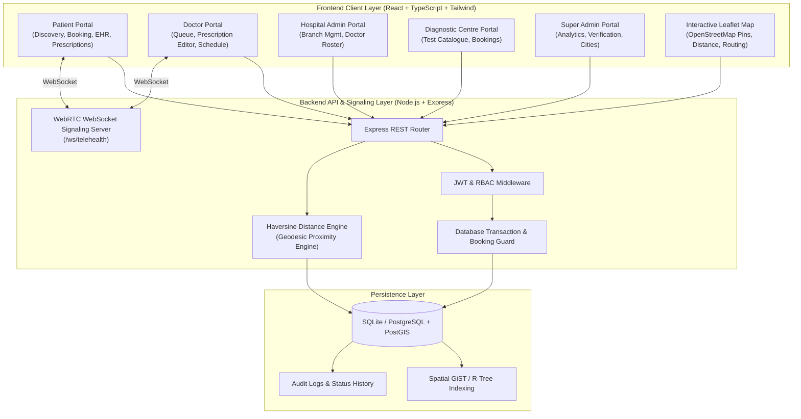

# CareNex – System Architecture & Technical Specification

## 1. High-Level Architecture Overview

## 2. Multi-City Geographic Engine

CareNex uses dual-mode geographic queries:
1. **Local Development & Fast Execution**: Custom Haversine trigonometric functions compute great-circle distance in kilometers:
   $$d = 2R \cdot \arcsin\left(\sqrt{\sin^2\left(\frac{\Delta\phi}{2}\right) + \cos(\phi_1)\cos(\phi_2)\sin^2\left(\frac{\Delta\lambda}{2}\right)}\right)$$
2. **Production Mode (PostgreSQL + PostGIS)**: Uses `ST_DWithin` and `ST_Distance` on `GEOGRAPHY(Point, 4326)` columns backed by GiST indexes for sub-millisecond radius filtering across millions of records.

## 3. Booking Engine & Concurrency Model

When an appointment booking request arrives:
1. `BEGIN TRANSACTION`
2. Slot existence and reservation check (`SELECT is_booked FROM doctor_slots WHERE id = ?`)
3. Concurrency conflict check: Query active appointments matching `doctor_id`, `branch_id`, `date`, `time`, and `status != 'CANCELLED'`. If matching record exists, `ROLLBACK` and return `409 Conflict`.
4. Insert into `appointments` with unique booking ID `CNX-YYYY-XXXXXX`.
5. Update `doctor_slots` to `is_booked = 1`.
6. Insert audit trail entry into `appointment_status_history`.
7. Insert notification for patient.
8. `COMMIT`
